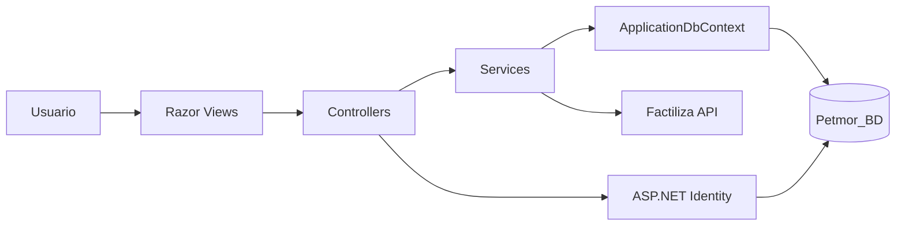

# 3. Pasos y diagramas de ingenieria inversa

## Pasos aplicados

1. Inventariar carpetas, proyectos, configuracion, vistas y servicios.
2. Identificar el punto de entrada en `Program.cs`.
3. Seguir el flujo HTTP: middleware, autenticacion, controlador y vista.
4. Identificar el modelo de datos en `ApplicationDbContext` y migraciones.
5. Relacionar roles con controladores mediante `[Authorize]`.
6. Revisar servicios transaccionales de ventas, atenciones y reservas.
7. Ejecutar build, pruebas y verificacion de login.
8. Documentar la arquitectura actual y sus dependencias.

## Flujo principal

## Capas identificadas

- Presentacion: `Views/` y `Areas/Identity/`.
- Aplicacion: `Controllers/`.
- Dominio: `Models/`.
- Servicios: `Services/`.
- Persistencia: `Data/` y `Migrations/`.
- Infraestructura: `Infrastructure/`.
- Calidad: `Tests/`.
