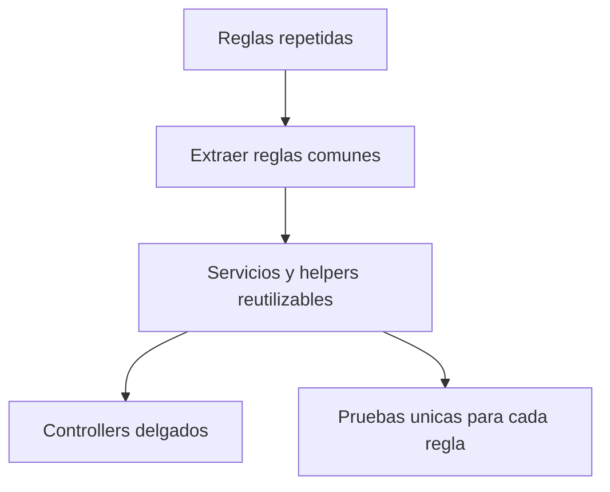

# 4. Refactorizacion aplicando DRY

## Problema

La validacion de fechas, la operacion de ventas, la gestion de reservas y la
lectura de codigos podian repetirse en varios controladores y vistas. Repetir
reglas aumenta el riesgo de que una correccion se aplique en un flujo y se omita
en otro.

## Solucion aplicada

- `FiltroFechas` centraliza la validacion de rangos.
- `OperacionVentaService` concentra reglas de venta y anulacion.
- `ReservaService` concentra el ciclo de reservas.
- `CodigosLecturas` centraliza limites y lectura de codigos.
- `PagoReglas` y `HoraPeru` reutilizan reglas transversales.

## Resultado

La regla se mantiene en un solo lugar, se reduce el codigo duplicado y las
pruebas pueden validar el comportamiento sin levantar toda la interfaz.
