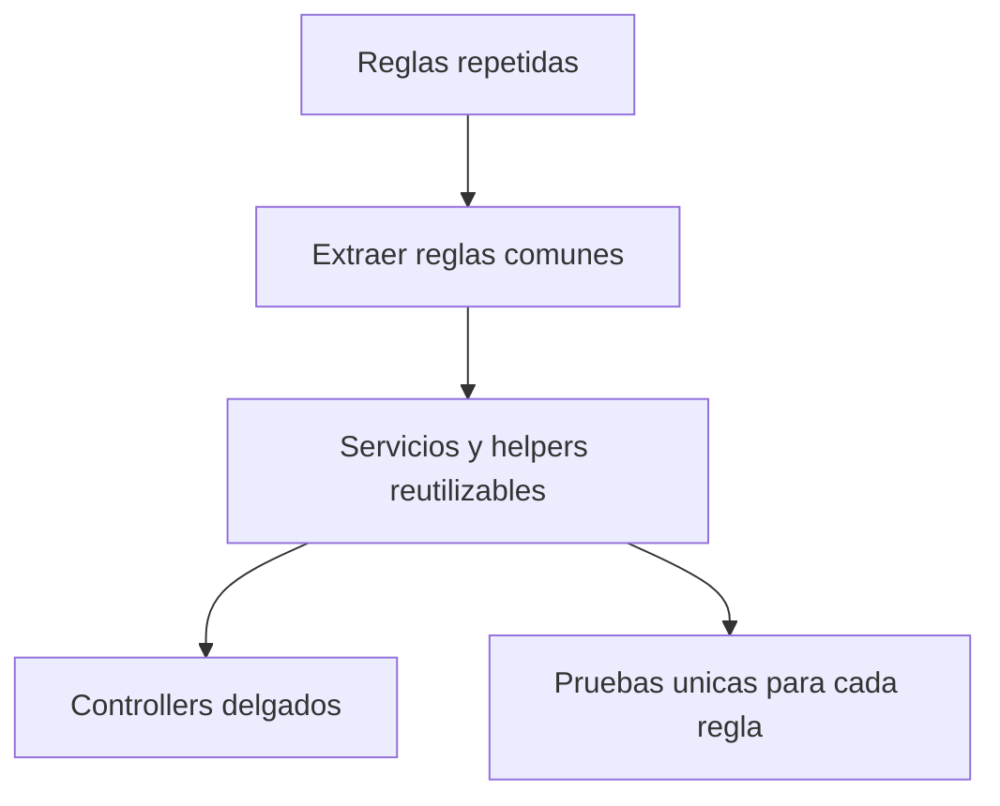
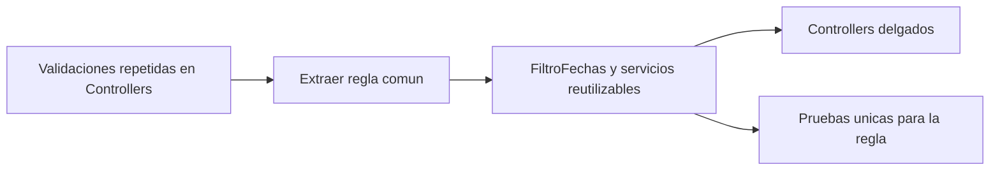

# 4. Refactorizacion aplicando DRY

## Problema: codigo repetido

En el flujo inicial, cada controlador podia validar las fechas por separado:

```csharp
// Antes: repetido en Ventas, Gastos y Reportes
if (fechaInicio > fechaFin)
{
    ModelState.AddModelError("", "La fecha inicial no puede ser posterior.");
    return View(model);
}
```

Si la regla cambiaba, habia que corregirla en varias acciones.

## Despues: una sola regla reutilizable

La regla se extrajo a `Infrastructure/FiltroFechas.cs` y se registra una vez:

```csharp
// Program.cs
options.Filters.Add(new Petmor.Web.Infrastructure.FiltroFechas());
```

```csharp
// FiltroFechas.cs
if (fechas.GetValueOrDefault(inicio) is DateTime d &&
    fechas.GetValueOrDefault(fin) is DateTime h && d.Date > h.Date)
    error = "La fecha inicial no puede ser posterior a la fecha final.";
```

Tambien se centralizaron las reglas de venta en `OperacionVentaService`, las
reservas en `ReservaService`, las lecturas en `CodigosLecturas` y los recargos
en `PagoReglas`.



## Resultado

La regla se mantiene en un solo lugar, se reduce el codigo duplicado y las
pruebas pueden validar el comportamiento sin levantar toda la interfaz.


