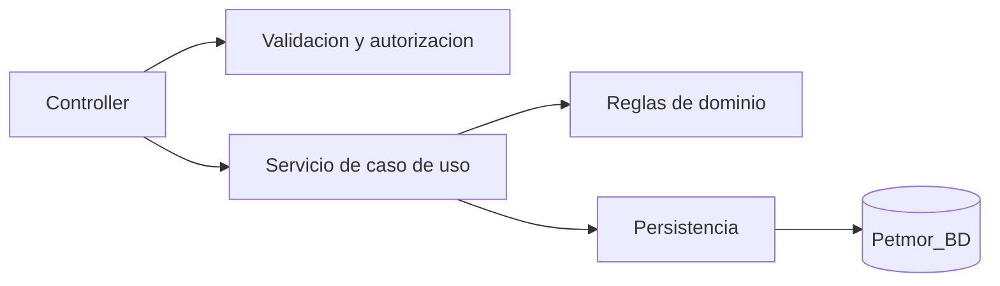

# 5. Refactorizacion aplicando Responsabilidad Unica

## Problema

Los controladores iniciales mezclaban autorizacion, validacion, reglas de
negocio, persistencia y construccion de respuestas.

## Refactorizacion

Se separaron responsabilidades mediante `AtencionService`,
`EmisionVentaService`, `OperacionVentaService`, `ReservaService`,
`ImagenSubida` y los servicios de lectura y sedes.

## Beneficios

- Menor complejidad por metodo.
- Pruebas unitarias mas directas.
- Cambios de negocio aislados.
- Menor riesgo de afectar vistas al cambiar persistencia.
