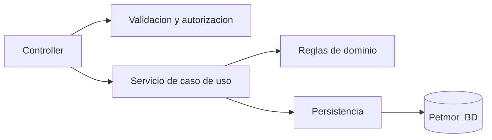

# 5. Refactorizacion aplicando Responsabilidad Unica

## Problema: muchas responsabilidades en una accion

El flujo inicial de una ficha de mascota podia concentrar validacion, guardado,
lectura de archivos y deteccion del tipo de imagen:

```csharp
// Antes: el controlador conocia todas las reglas de archivos
await foto.CopyToAsync(stream);
var bytes = stream.ToArray();
if (bytes[0] != 255 || bytes[1] != 216 || bytes[2] != 255)
    throw new InvalidOperationException("Imagen invalida");
db.ArchivosClinicos.Add(new ArchivoClinico { Contenido = bytes });
```

Esto hacia que el controlador fuera dificil de probar y mantener.

## Despues: responsabilidades separadas

El controlador conserva el caso de uso y delega la validacion especializada:

```csharp
// ConfiguracionController.cs
var extension = await ImagenSubida.Extension(model.LogoUpload);
```

```csharp
// Services/ImagenSubida.cs
public static async Task<string> Extension(IFormFile archivo)
{
    if (archivo.Length is < 12 or > 5_000_000)
        throw new InvalidOperationException("Seleccione una imagen de hasta 5 MB.");
    // Verifica la firma real PNG, JPEG, GIF o WebP.
}
```

De la misma forma, `AtencionService`, `ReservaService`,
`OperacionVentaService` y `EmisionVentaService` concentran un caso de uso cada
uno.



Se separaron responsabilidades mediante `AtencionService`,
`EmisionVentaService`, `OperacionVentaService`, `ReservaService`,
`ImagenSubida` y los servicios de lectura y sedes.

## Beneficios

- Menor complejidad por metodo.
- Pruebas unitarias mas directas.
- Cambios de negocio aislados.
- Menor riesgo de afectar vistas al cambiar persistencia.
