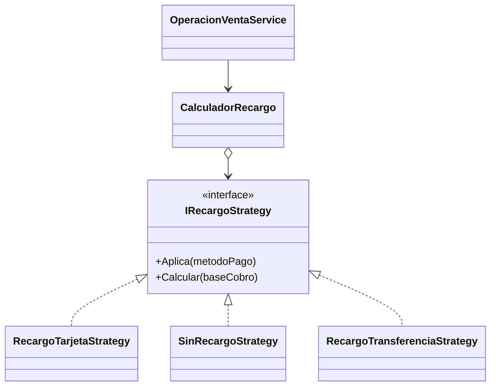
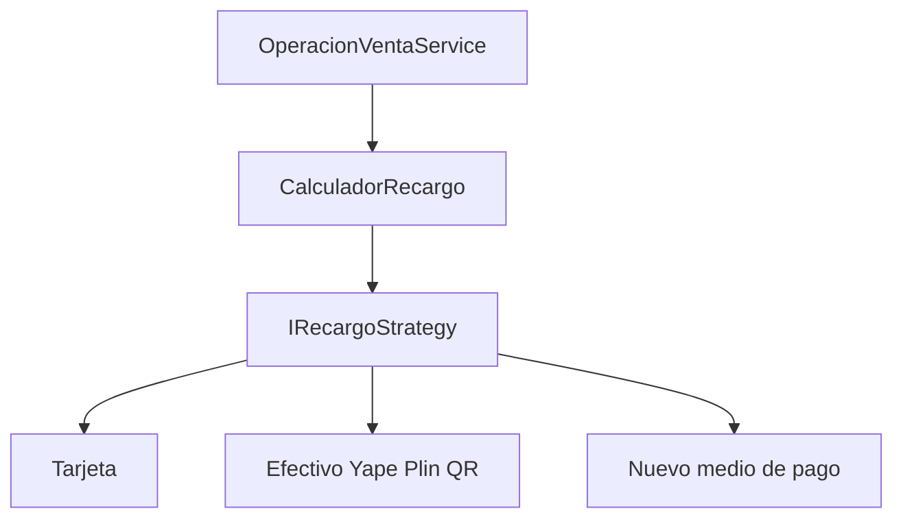

# 9.3 Aplicacion OCP (Abierto/Cerrado)

## Uso de interfaces, estrategias y extensibilidad

El principio Abierto/Cerrado establece que el sistema debe estar abierto para
extender su comportamiento, pero cerrado para modificar el codigo estable. En
Petmor se aplica al calculo de recargos segun el medio de pago.

## Problema inicial

La implementacion inicial resolvia el recargo directamente en cada flujo:

```csharp
// Antes: cada controlador conocia la regla comercial
var recargo = metodoPago == "Tarjeta"
    ? Math.Round(total * 0.05m, 2)
    : 0m;
```

Al agregar otro medio de pago, habia que buscar y modificar varios flujos.
Esto aumentaba la duplicacion y el riesgo de que dos pantallas calcularan
importes diferentes.

## Solucion: interfaz y estrategias

Se define una interfaz para las estrategias de recargo:

```csharp
public interface IRecargoStrategy
{
    bool Aplica(string metodoPago);
    decimal Calcular(decimal baseCobro);
}
```

Cada medio de pago encapsula su propia regla:

```csharp
public sealed class RecargoTarjetaStrategy : IRecargoStrategy
{
    public bool Aplica(string metodoPago) => metodoPago == "Tarjeta";

    public decimal Calcular(decimal baseCobro) =>
        decimal.Round(baseCobro * 0.05m, 2, MidpointRounding.AwayFromZero);
}

public sealed class SinRecargoStrategy : IRecargoStrategy
{
    public bool Aplica(string metodoPago) =>
        metodoPago is "Efectivo" or "Yape" or "Plin" or "QR";

    public decimal Calcular(decimal baseCobro) => 0m;
}
```

El calculador depende de la abstraccion y no conoce los detalles de cada
estrategia:

```csharp
public sealed class CalculadorRecargo(IEnumerable<IRecargoStrategy> estrategias)
{
    public decimal Calcular(string metodoPago, decimal baseCobro) =>
        estrategias.First(x => x.Aplica(metodoPago)).Calcular(baseCobro);
}
```

Las estrategias se registran en el contenedor de dependencias:

```csharp
builder.Services.AddScoped<IRecargoStrategy, RecargoTarjetaStrategy>();
builder.Services.AddScoped<IRecargoStrategy, SinRecargoStrategy>();
builder.Services.AddScoped<CalculadorRecargo>();
```

El servicio de ventas solo utiliza `CalculadorRecargo`:

```csharp
public class OperacionVentaService(
    ApplicationDbContext db,
    CalculadorRecargo recargos)
{
    var recargo = recargos.Calcular(request.MetodoPago, baseCobro);
}
```

## Extension sin modificar codigo estable

Para agregar `Transferencia`, se crea una nueva estrategia:

```csharp
public sealed class RecargoTransferenciaStrategy : IRecargoStrategy
{
    public bool Aplica(string metodoPago) => metodoPago == "Transferencia";

    public decimal Calcular(decimal baseCobro) =>
        decimal.Round(baseCobro * 0.02m, 2, MidpointRounding.AwayFromZero);
}
```

Luego se registra la nueva estrategia:

```csharp
builder.Services.AddScoped<IRecargoStrategy, RecargoTransferenciaStrategy>();
```

No se modifica `OperacionVentaService`, los controladores ni las estrategias
existentes. El codigo estable queda cerrado a modificaciones y la funcionalidad
queda abierta a extensiones mediante nuevas estrategias.

## Aplicacion en Petmor

La regla actual se concentra en `Infrastructure/PagoReglas.cs` y es utilizada
por `PetmorController`, `ReservasController` y `OperacionVentaService`. El
patron de estrategias conserva el comportamiento actual para Tarjeta, Efectivo,
Yape, Plin y QR, pero permite evolucionar hacia una arquitectura extensible sin
duplicar reglas comerciales.

Las areas veterinaria y spa tambien se representan mediante `AreaAtencion`, y
sus operaciones se extienden en servicios especializados.




