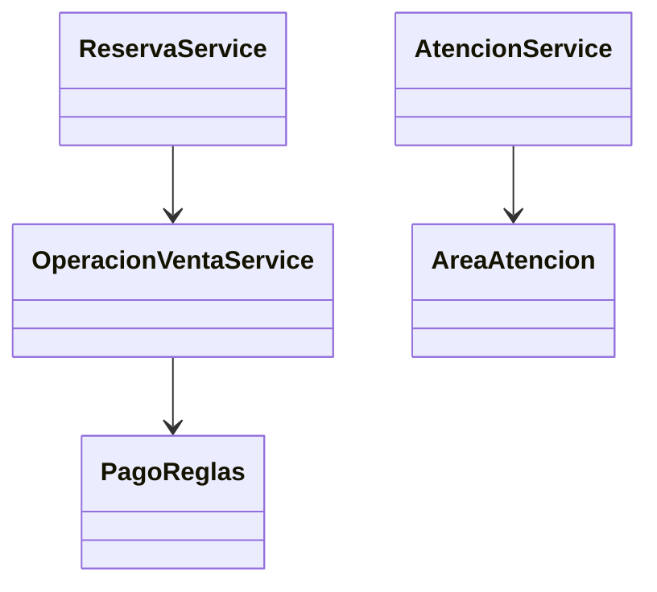
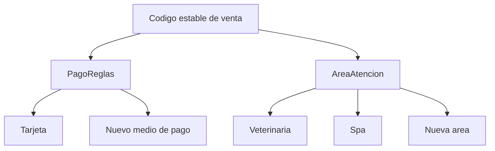

# 6. Refactorizacion aplicando Abierto/Cerrado

## Problema: modificar codigo existente para cada extension

Una implementacion inicial podia resolver el recargo directamente en cada
controlador:

```csharp
// Antes: cada flujo conocia la regla comercial
var recargo = metodoPago == "Tarjeta"
    ? Math.Round(total * 0.05m, 2)
    : 0m;
```

Al agregar otro medio de pago, habia que buscar y modificar varios flujos.

## Despues: regla central y extensible

La regla se concentra en `Infrastructure/PagoReglas.cs`:

```csharp
public static class PagoReglas
{
    public const decimal RecargoTarjetaPct = 0.05m;

    public static decimal CalcularRecargo(string metodoPago, decimal baseCobro) =>
        metodoPago == "Tarjeta"
            ? decimal.Round(baseCobro * RecargoTarjetaPct, 2,
                MidpointRounding.AwayFromZero)
            : 0m;
}
```

El flujo de venta utiliza la regla sin duplicarla. Las areas veterinaria y spa
se representan mediante `AreaAtencion`, y sus operaciones se extienden en
servicios especializados.



## Ejemplo de extension

Agregar una nueva modalidad de atencion debe ampliar `AreaAtencion`, sus reglas
y su vista especifica, sin duplicar el proceso de cobro o inventario.


