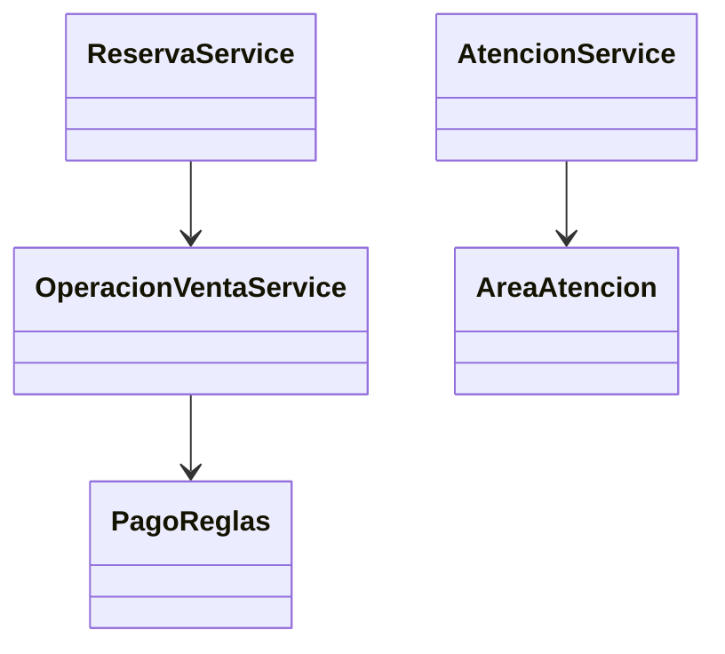

# 6. Refactorizacion aplicando Abierto/Cerrado

## Problema

Agregar nuevas areas de atencion, reglas de pago o validaciones podia requerir
modificar condicionales existentes en varios puntos.

## Solucion

Se usan enumeraciones y servicios especializados para extender el sistema sin
reescribir los flujos principales. Las nuevas areas se incorporan al modelo y
a sus reglas, mientras los controladores consumen abstracciones estables.

## Ejemplo

Agregar una nueva modalidad de atencion debe ampliar `AreaAtencion`, sus reglas
y su vista especifica, sin duplicar el proceso de cobro o inventario.
