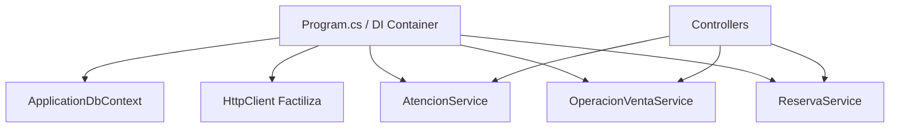
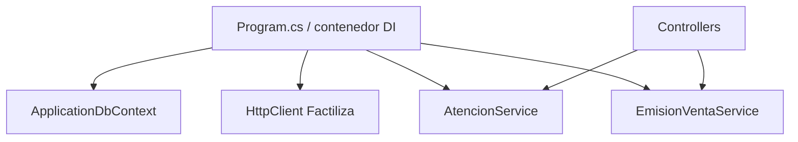

# 7. Refactorizacion aplicando Inversion de Control

## Problema: dependencias creadas dentro de las clases

El enfoque inicial podia crear sus dependencias dentro del controlador:

```csharp
// Antes: acoplamiento directo y dificil de sustituir en pruebas
var db = new ApplicationDbContext(opciones);
var cliente = new HttpClient();
```

La clase quedaba responsable de decidir como construir la base de datos y el
cliente HTTP.

## Despues: dependencias inyectadas

El controlador recibe sus dependencias por constructor:

```csharp
public class PetmorController(
    ApplicationDbContext db,
    AtencionService operaciones,
    EmisionVentaService emision) : Controller
{
    // El controlador usa servicios, pero no los crea.
}
```

ASP.NET Core registra y construye el grafo en `Program.cs`:

```csharp
builder.Services.AddScoped<Petmor.Web.Services.AtencionService>();
builder.Services.AddScoped<Petmor.Web.Services.EmisionVentaService>();
builder.Services.AddHttpClient<Petmor.Web.Services.FactilizaService>();
```



## Beneficios

- Menor acoplamiento.
- Sustitucion de dependencias en pruebas.
- Configuracion centralizada.
- Ciclo de vida controlado por ASP.NET Core.


