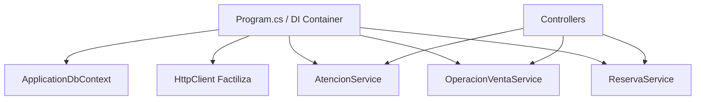

# 7. Refactorizacion aplicando Inversion de Control

## Problema

Los componentes que crean directamente acceso a datos, proteccion de tokens o
clientes HTTP son dificiles de sustituir durante las pruebas.

## Solucion aplicada

ASP.NET Core construye el grafo de dependencias en `Program.cs` y lo inyecta en
controladores y servicios.

## Beneficios

- Menor acoplamiento.
- Sustitucion de dependencias en pruebas.
- Configuracion centralizada.
- Ciclo de vida controlado por ASP.NET Core.
