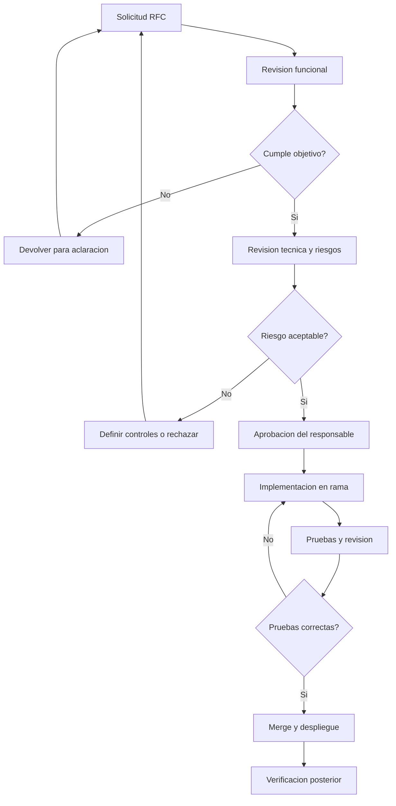

# 11. Flujo de aprobacion del cambio

## Evidencias requeridas

- RFC aprobada.
- Diferencia de codigo revisada.
- Build y pruebas.
- Capturas del comportamiento.
- Registro del commit y version publicada.
