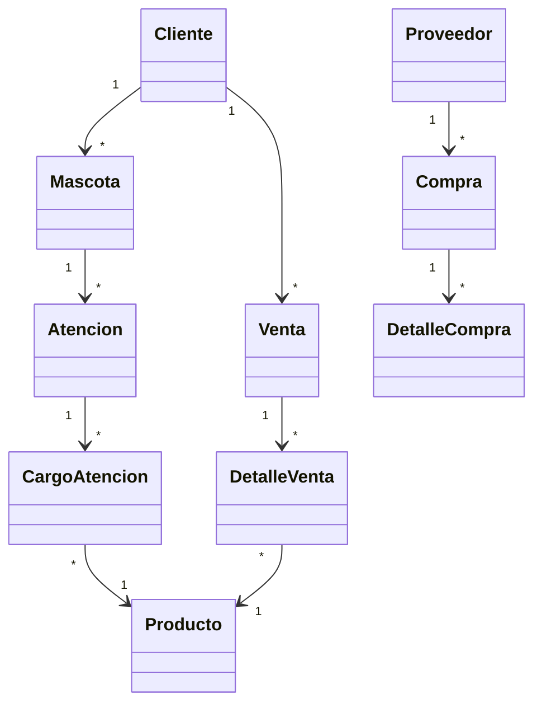
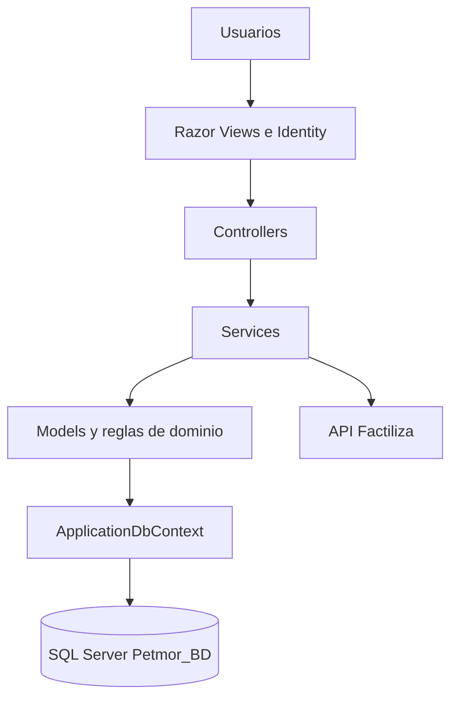

# Informe de mantenimiento e ingenieria de Petmor

## 1. Diagnostico del software inicial

La version inicial presentaba funcionalidad operativa, pero tenia problemas de
organizacion, duplicacion y acoplamiento. Tambien existian referencias
heredadas de MiniMarket y AmayaSoft que no representaban el dominio veterinario
de Petmor.

### Problemas tecnicos encontrados

| Problema | Descripcion | Consecuencia |
|---|---|---|
| Codigo duplicado | Validaciones de fechas, pagos y lecturas repetidas en controladores. | Correcciones repetitivas y riesgo de inconsistencias. |
| Alto acoplamiento | Controladores conocian reglas, persistencia y archivos. | Pruebas y cambios mas costosos. |
| Mala estructura | Una accion podia validar, guardar y procesar archivos. | Baja cohesion y mayor complejidad. |
| Nombres heredados | Referencias MiniMarket y AmayaSoft. | Confusion de dominio. |
| Configuracion inconsistente | Diferentes nombres de base y configuraciones antiguas. | Instalacion poco reproducible. |
| Documentacion desactualizada | Documentos basados en Django y SQLite. | El informe no coincidia con el sistema actual. |

### Evidencia de codigo antes

```csharp
// Validacion repetida en Ventas, Gastos y Reportes
if (fechaInicio > fechaFin)
{
    ModelState.AddModelError("", "La fecha inicial no puede ser posterior.");
    return View(model);
}
```

```csharp
// Controlador con validacion de archivos y persistencia mezcladas
await foto.CopyToAsync(stream);
var bytes = stream.ToArray();
if (bytes[0] != 255 || bytes[1] != 216 || bytes[2] != 255)
    throw new InvalidOperationException("Imagen invalida");
db.ArchivosClinicos.Add(new ArchivoClinico { Contenido = bytes });
```

```csharp
// Dependencias creadas directamente
var db = new ApplicationDbContext(opciones);
var clienteHttp = new HttpClient();
```

## 2. Ingenieria inversa del software

### Pasos realizados

1. Inventario de carpetas, proyectos, configuracion y vistas.
2. Identificacion del punto de entrada en `Program.cs`.
3. Seguimiento del flujo HTTP entre vistas, controladores y servicios.
4. Analisis de `ApplicationDbContext` y migraciones.
5. Identificacion de roles y autorizaciones.
6. Revision de ventas, reservas, atenciones e inventario.
7. Ejecucion de build, pruebas y login.

### Diagrama de clases inicial



### Diagrama de arquitectura por capas



### Casos de uso principales

| Actor | Caso de uso | Resultado |
|---|---|---|
| Administrador | Gestionar usuarios y roles | Control de acceso por perfil. |
| Recepcionista | Registrar clientes y mascotas | Datos actualizados del propietario y paciente. |
| Veterinario | Registrar atencion | Historia, diagnostico e indicaciones. |
| Groomer | Gestionar spa | Servicios de grooming y seguimiento. |
| Administrador | Gestionar inventario | Stock, compras y kardex. |
| Recepcionista | Registrar venta | Venta, pago y comprobante. |
| Administrador | Gestionar caja y reportes | Control financiero y analisis. |

## 3. Refactorizacion y evidencia antes/despues

### DRY

Antes, cada controlador validaba fechas de forma independiente. Despues, la
regla se centralizo en `Infrastructure/FiltroFechas.cs` y se registra una sola
vez en `Program.cs`:

```csharp
// Despues
options.Filters.Add(new Petmor.Web.Infrastructure.FiltroFechas());
```

La misma estrategia se aplico a `OperacionVentaService`, `ReservaService`,
`CodigosLecturas` y `PagoReglas`.

### Responsabilidad unica

Antes, el controlador procesaba la imagen y la guardaba. Despues, delega la
validacion especializada:

```csharp
// Despues
var extension = await ImagenSubida.Extension(model.LogoUpload);
```

Los casos de uso se separaron en `AtencionService`, `ReservaService`,
`OperacionVentaService`, `EmisionVentaService` e `ImagenSubida`.

### 9.3 Aplicacion OCP (Abierto/Cerrado)

La aplicacion OCP se realiza mediante interfaces y estrategias para calcular
recargos por medio de pago. Antes, cada flujo podia contener su propia
condicion:

```csharp
var recargo = metodoPago == "Tarjeta"
    ? Math.Round(total * 0.05m, 2)
    : 0m;
```

Despues, el calculador depende de una interfaz y recibe las estrategias por
inyeccion de dependencias:

```csharp
public interface IRecargoStrategy
{
    bool Aplica(string metodoPago);
    decimal Calcular(decimal baseCobro);
}

public sealed class RecargoTarjetaStrategy : IRecargoStrategy
{
    public bool Aplica(string metodoPago) => metodoPago == "Tarjeta";
    public decimal Calcular(decimal baseCobro) =>
        decimal.Round(baseCobro * 0.05m, 2, MidpointRounding.AwayFromZero);
}

public sealed class CalculadorRecargo(IEnumerable<IRecargoStrategy> estrategias)
{
    public decimal Calcular(string metodoPago, decimal baseCobro) =>
        estrategias.First(x => x.Aplica(metodoPago)).Calcular(baseCobro);
}
```

Para agregar `Transferencia`, se crea `RecargoTransferenciaStrategy` y se
registra `builder.Services.AddScoped<IRecargoStrategy, RecargoTransferenciaStrategy>()`.
No se modifica `OperacionVentaService`, por lo que el codigo estable queda
cerrado a cambios y el comportamiento queda abierto a nuevas estrategias.

### Inversion de control

Antes, las clases creaban directamente sus dependencias. Despues, ASP.NET Core
las inyecta mediante constructor:

```csharp
public class PetmorController(
    ApplicationDbContext db,
    AtencionService operaciones,
    EmisionVentaService emision) : Controller
{
}
```

```csharp
builder.Services.AddScoped<Petmor.Web.Services.AtencionService>();
builder.Services.AddScoped<Petmor.Web.Services.EmisionVentaService>();
builder.Services.AddHttpClient<Petmor.Web.Services.FactilizaService>();
```

## 4. Plan de mantenimiento preventivo

### Actividades planificadas

| Actividad | Frecuencia | Prioridad |
|---|---|---|
| Ejecutar build y pruebas | Cada cambio | Alta |
| Revisar autenticacion, roles y antiforgery | Cada sprint | Alta |
| Respaldar `Petmor_BD` | Semanal | Alta |
| Revisar vulnerabilidades NuGet | Mensual | Alta |
| Revisar logs y errores | Semanal | Media |
| Revisar indices e integridad de base | Mensual | Media |
| Actualizar diagramas y documentacion | Mensual | Media |
| Limpiar codigo duplicado | Cada sprint | Baja |

### Prioridades

- **Alta:** seguridad, respaldos, disponibilidad y pruebas.
- **Media:** rendimiento, logs, interfaz y documentacion.
- **Baja:** limpieza de codigo y mejoras visuales no criticas.

### Cronograma por semanas

| Semana | Actividad | Entregable |
|---|---|---|
| 1 | Revisar estructura y compilacion. | Diagnostico tecnico. |
| 2 | Revisar autenticacion, roles y secretos. | Lista de controles de seguridad. |
| 3 | Ejecutar y ampliar pruebas. | Evidencia de pruebas. |
| 4 | Revisar base de datos y respaldos. | Respaldo y reporte. |
| 5 | Revisar duplicacion y responsabilidades. | Propuesta de refactorizacion. |
| 6 | Actualizar documentacion y diagramas. | Informe actualizado. |
| 7 | Corregir defectos encontrados. | Version candidata. |
| 8 | Verificacion final y publicacion. | Version estable. |

### Criterios de aceptacion

- El proyecto compila correctamente.
- Las pruebas automatizadas terminan sin errores.
- No existen secretos en el repositorio.
- La base tiene respaldo reciente.
- Los roles y permisos funcionan correctamente.
- La documentacion coincide con la version publicada.
- La aplicacion inicia mediante `ejecutar.cmd`.
