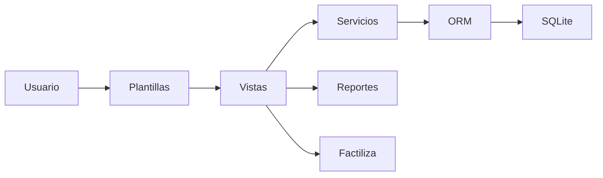
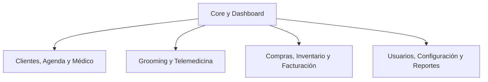
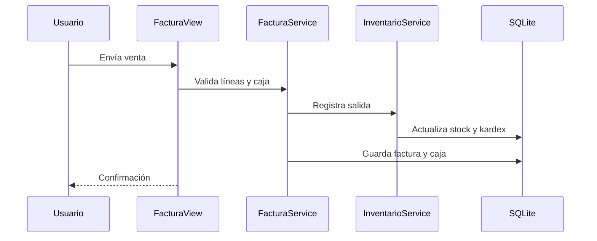

# 3. Pasos y diagramas de ingeniería inversa

## Pasos realizados

1. Identificar `manage.py` como punto de entrada.
2. Revisar `veterinaria/settings.py` para conocer configuración y dependencias.
3. Revisar `veterinaria/urls.py` y los `urls.py` de cada aplicación.
4. Inventariar modelos y migraciones para reconstruir entidades y relaciones.
5. Seguir los flujos de clientes, citas, historias, compras, inventario, ventas y caja.
6. Revisar servicios de negocio y formularios.
7. Relacionar vistas con plantillas y recursos estáticos.
8. Ejecutar pruebas y validar la aplicación desde una base SQLite vacía.

## Arquitectura recuperada

## Módulos identificados

## Flujo de una venta

