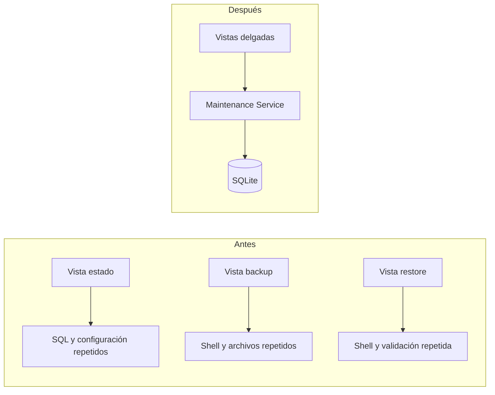

# 4. Refactorización aplicando DRY

## Problema inicial

Las vistas de mantenimiento repetían operaciones para abrir la base, consultar tablas, crear carpetas, generar backups y ejecutar comandos externos. La misma responsabilidad estaba distribuida en varios bloques similares.

## Solución aplicada

Se creó `apps/core/maintenance.py`, que concentra las operaciones reutilizables:

- `get_database_status()`.
- `create_sqlite_backup()`.
- `validate_sqlite_backup()`.
- `restore_sqlite_backup()`.
- `reset_business_data()`.

## Diagrama antes y después

## Beneficio

El código común se mantiene en un único lugar. Si cambia la estrategia de respaldo o validación, se modifica el servicio sin duplicar cambios en varias vistas.
