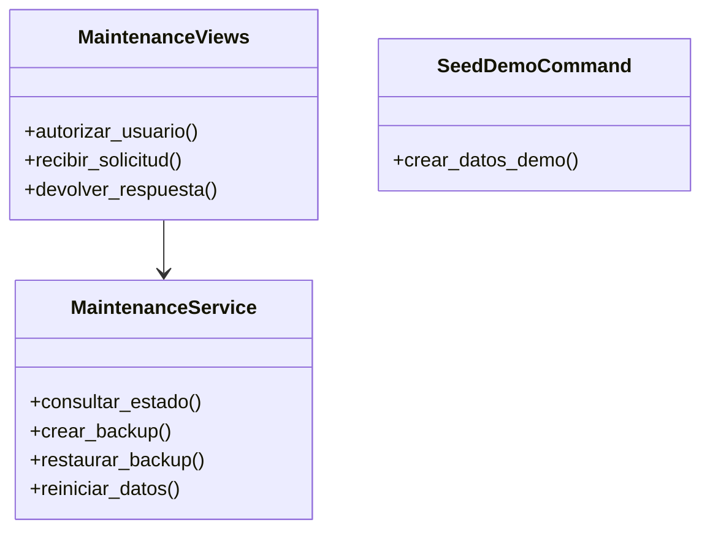

# 5. Refactorización aplicando Responsabilidad Única

## Problema inicial

`apps/core/views.py` realizaba simultáneamente autorización, consultas SQL, cálculo de tamaño, creación de directorios, ejecución de comandos, restauración y eliminación de datos.

## Solución aplicada

Se dividieron las responsabilidades:

| Componente | Responsabilidad |
| --- | --- |
| `views.py` | Recibir solicitudes, autorizar y devolver respuestas |
| `maintenance.py` | Ejecutar operaciones sobre SQLite |
| `seed_demo.py` | Crear datos ficticios reproducibles |
| `setup.ps1` | Crear entorno e instalar dependencias |
| `start.ps1` | Iniciar el servidor |
| `test.ps1` | Ejecutar verificaciones |

## Diagrama

## Beneficio

Cada componente tiene un motivo claro para cambiar. Esto facilita las pruebas, reduce el acoplamiento y permite localizar errores más rápidamente.
