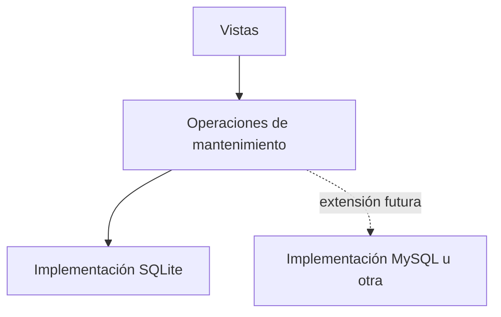

# 6. Refactorización aplicando Abierto/Cerrado

## Problema inicial

Las vistas estaban directamente acopladas a comandos, SQL y detalles de MySQL. Agregar otra estrategia de almacenamiento obligaba a modificar la lógica HTTP.

## Solución aplicada

Las vistas dependen de operaciones de mantenimiento definidas en el servicio. La implementación actual trabaja con SQLite y puede extenderse posteriormente sin volver a introducir comandos de shell en las vistas.

## Diagrama

## Ejemplo

La vista solicita crear un respaldo mediante `create_sqlite_backup()`. La vista no conoce cómo se copia físicamente la base ni cómo se valida el archivo.

## Beneficio

El módulo queda abierto a nuevas implementaciones y cerrado a cambios innecesarios en las vistas y plantillas.
