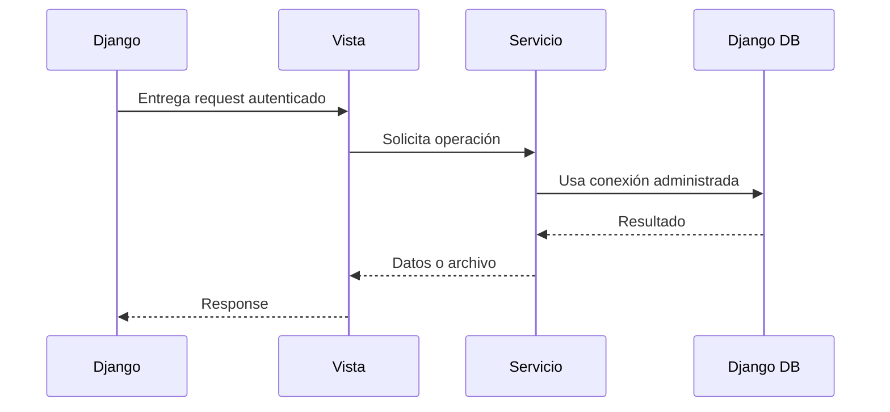

# 7. Refactorización aplicando Inversión de Control

## Situación inicial

Las vistas creaban procesos externos y construían comandos SQL de MySQL directamente. La capa web controlaba detalles que correspondían a infraestructura.

## Solución aplicada

La aplicación utiliza las abstracciones proporcionadas por Django:

- `django.db.connection` para la conexión activa.
- ORM para eliminar datos respetando relaciones.
- Introspección de Django para obtener tablas.
- `FileResponse` para entregar respaldos.
- Decoradores Django para autenticación y métodos HTTP.

## Diagrama

## Beneficio

Django controla el ciclo de vida de la petición y de la conexión. Las vistas ya no necesitan crear conexiones, invocar `mysqldump` ni administrar procesos externos.
