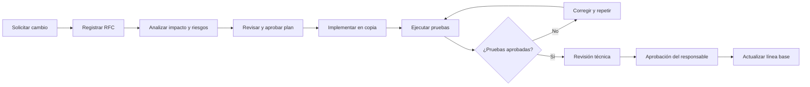

# 11. Flujo de aprobación del cambio

## Flujo propuesto

## Responsables

| Etapa | Responsable |
| --- | --- |
| Solicitud | Usuario o integrante del equipo |
| Análisis | Líder técnico |
| Revisión | Equipo de desarrollo |
| Pruebas | Responsable de calidad |
| Aprobación | Docente o responsable del proyecto |
| Liberación | Líder técnico |

## Criterios de aprobación

- El cambio está descrito y justificado.
- Se conocen los archivos afectados.
- Se identificaron riesgos y reversión.
- Las pruebas automatizadas pasan.
- No se incluyen secretos ni datos reales.
- La documentación queda actualizada.

## Aplicación al RFC-001

El cambio de SQLite fue analizado, implementado en una copia, probado con migraciones, seed, mantenimiento, smoke tests y revisión de seguridad. La copia original se conservó como respaldo de la línea base anterior.
