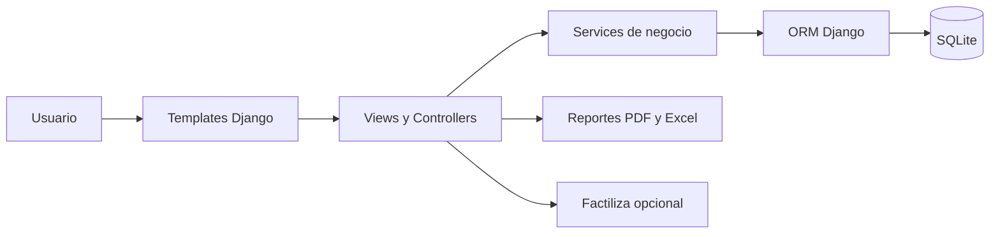
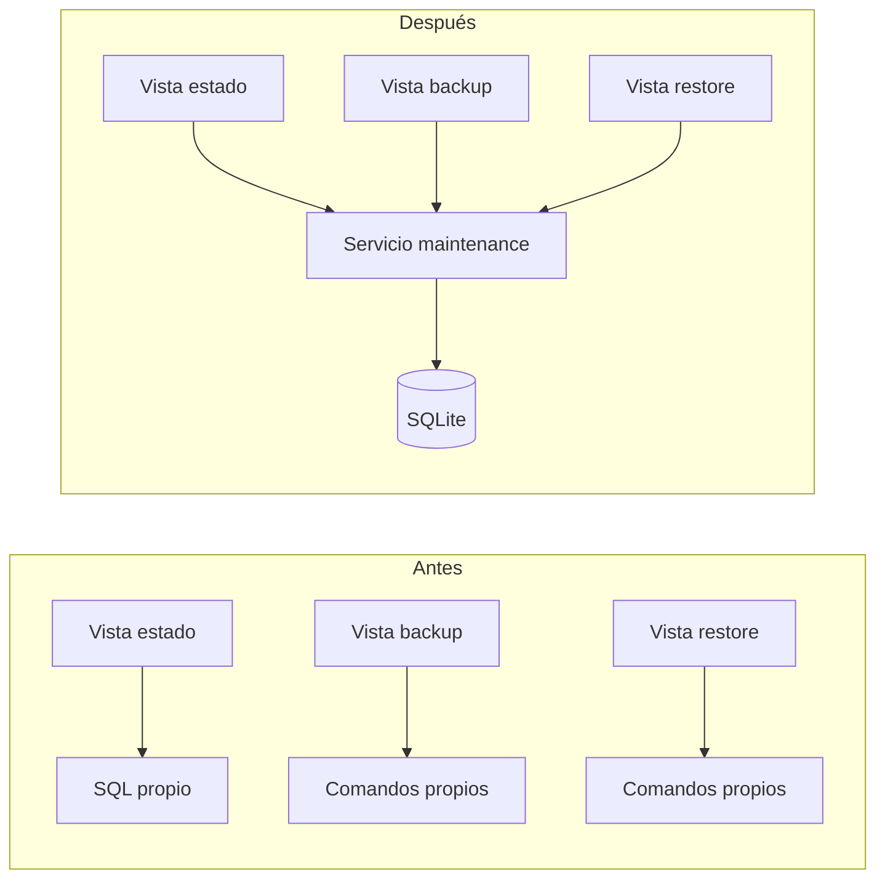
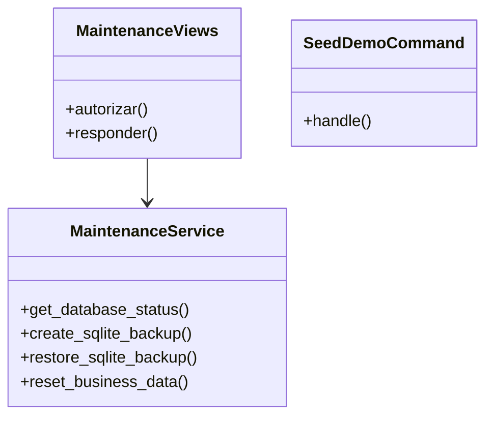
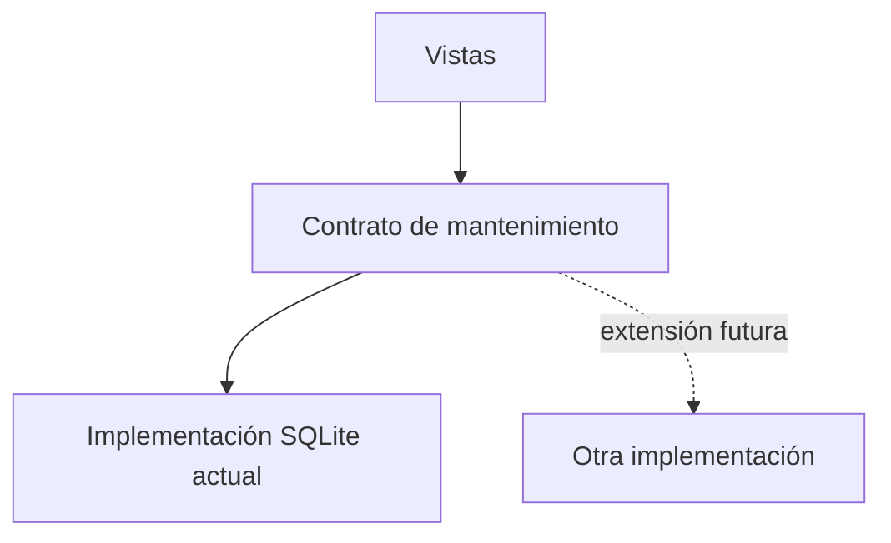
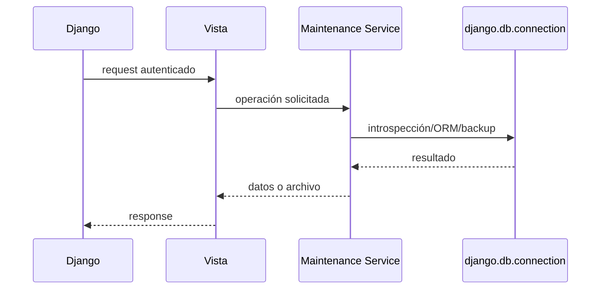

# Diagnóstico, ingeniería inversa y refactorización

## 1. Descripción del proyecto

Petmor es un sistema web monolítico para una veterinaria con servicios de spa. Centraliza procesos clínicos, agenda, ventas, compras, inventario, caja, mantenimiento y reportes en una aplicación Django.

## 2. Diagnóstico inicial

El software inicial ya contenía los módulos funcionales principales, migraciones y reglas transaccionales para inventario, compras y ventas. Sin embargo, la entrega mezclaba código Django con un proyecto ASP.NET de referencia, entorno virtual no portable, respaldos, datos personales y credenciales.

Problemas técnicos relevantes:

- MySQL era el motor predeterminado aunque el script local forzaba SQLite.
- Mantenimiento ejecutaba SQL y programas exclusivos de MySQL.
- Bootstrap, Font Awesome, Google Fonts y Chart.js dependían de CDN.
- El entorno virtual contenía rutas absolutas y versiones diferentes de Python.
- No existía carga reproducible de datos de demostración.
- La configuración permitía cualquier host y contenía una clave fija.
- Las vistas de mantenimiento concentraban HTTP, SQL, archivos y procesos externos.

## 3. Ingeniería inversa

Se reconstruyó la arquitectura leyendo configuración, rutas, modelos, formularios, servicios, plantillas y migraciones.

Pasos ejecutados:

1. Identificación del entrypoint `manage.py` y configuración `veterinaria/settings.py`.
2. Inventario de aplicaciones y rutas.
3. Reconstrucción de entidades y relaciones desde modelos/migraciones.
4. Seguimiento de flujos de compra, kardex, venta, caja y grooming.
5. Identificación de dependencias externas, datos sensibles y artefactos generados.
6. Ejecución de pruebas sobre una copia saneada.

## 4. DRY

Antes, las operaciones de mantenimiento repetían acceso a configuración, creación de directorios y manejo de base en cada vista. Ahora existe un único módulo `apps/core/maintenance.py`.

## 5. Responsabilidad Única

Las vistas ahora autorizan, reciben solicitudes y construyen respuestas. El servicio de mantenimiento inspecciona, respalda, valida, restaura y reinicia la base. Los scripts PowerShell gestionan instalación/inicio y `seed_demo` gestiona datos ficticios.

## 6. Abierto/Cerrado

Las vistas dependen de funciones con contratos definidos. Una estrategia futura para otra base puede añadirse detrás de esas operaciones sin volver a mezclar comandos de infraestructura con HTTP. Las reglas de compras, ventas, inventario y grooming siguen encapsuladas en sus servicios existentes.

## 7. Inversión de Control

Django controla el ciclo de vida HTTP, inyecta `request`, selecciona configuración y entrega la conexión mediante `django.db.connection`. El mantenimiento usa estas abstracciones en lugar de crear conexiones MySQL o ejecutar programas externos desde las vistas.

## 8. Resultados

- Entrega independiente sin datos reales ni secretos.
- Instalación repetible con Python 3.10+.
- SQLite como única base local, sin XAMPP ni MySQL.
- Datos ficticios listos para todas las pantallas principales.
- Mantenimiento compatible y probado.
- Interfaz disponible sin CDN.
- Pruebas de regresión, idempotencia, mantenimiento y humo.
