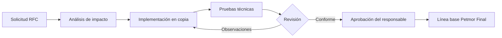

# RFC-001: Estandarizar la ejecución local con SQLite

## Estado

Aprobado para la entrega T2.

## Solicitud

Reemplazar la configuración local dual MySQL/SQLite por una instalación demostrativa exclusivamente SQLite, portable y libre de información real.

## Motivo

La configuración anterior requería MySQL por defecto, mientras que el script local forzaba SQLite. El módulo de mantenimiento continuaba usando SQL y ejecutables de MySQL, produciendo un sistema inconsistente y difícil de instalar en otra computadora.

## Alcance

- SQLite como motor único de la entrega.
- Eliminación de `mysqlclient`.
- Mantenimiento nativo para SQLite.
- Seed idempotente de datos ficticios.
- Scripts de instalación, inicio y prueba.
- Recursos frontend locales.

## Impacto

Positivo: menos dependencias, instalación simple, demostración reproducible y menor exposición de datos. La edición MySQL original no se modifica.

Limitación: esta entrega está destinada a uso local y no representa el diseño de base de datos para producción multiusuario.

## Riesgos y controles

| Riesgo | Control |
| --- | --- |
| Duplicar stock al recargar demos | Identificadores estables y prueba de doble ejecución |
| Restaurar un archivo falso | Cabecera, integridad y tablas obligatorias |
| Perder datos durante restauración | Respaldo preventivo y reemplazo atómico |
| Depender de Internet al exponer | Bootstrap, iconos y Chart.js locales |
| Filtrar información real | Copia por lista permitida y escaneo final |

## Validación

- `manage.py check`.
- Migraciones desde base vacía.
- `seed_demo` dos veces sin cambios en conteos/stock.
- Suite completa de pruebas.
- Navegación de módulos y prueba sin Internet.

## Flujo de aprobación

## Reversión

Eliminar `Petmor_Final` y volver a generar la entrega desde el proyecto original, que permanece sin modificaciones. Para datos locales, restaurar el último `.sqlite3` validado desde Mantenimiento.
